<p align="center">
  
</p>

<p align="center">
  <a href="https://abhijithwarrier.in"></a>
  <a href="https://awdevrethought.com"></a>
  <a href="https://www.linkedin.com/in/abhijith-warrier-228605184"></a>
  <a href="https://instagram.com/python_scripts"></a>
  <a href="https://www.youtube.com/@awdevrethought"></a>
  <a href="https://discord.gg/NWPwSrZ296"></a>
</p>

<br/>

## `01` &nbsp;whoami

<table>
<tr>
<td width="64%" valign="top">

```python
class AbhijithWarrier(Engineer):
    role      = "Technical Lead @ Bluepineapple"   # since 2021
    previously= "System Architect @ FastUp"        # AWS automation
    based_in  = "Kerala, India 🇮🇳"
    focus     = ["Cloud", "AI / ML", "Automation"]

    stack = {
        "backend":  ["Python", "Django", "Node.js", "GraphQL"],
        "frontend": ["Next.js", "React", "Shopify Storefronts"],
        "cloud":    ["AWS", "Azure", "Docker", "CI/CD"],
        "data":     ["SQL", "Data Modeling", "Analytics Pipelines"],
        "ai":       ["ML", "NLP", "GenAI / LLMs", "MLOps"],
    }

    certified = "AWS ×5 · Cloud Practitioner → Solutions Architect Pro"
    building  = ["internal tools", "Shopify apps", "automation frameworks"]
    writing   = "AW Dev Rethought · Radar, Flash & deep dives"
    teaching  = "@python_scripts · bite-size Python & AI, weekly"
    streaming = "YouTube · @awdevrethought"

    def motto(self) -> str:
        return "Code smarter. Build bigger. Share freely."
```

</td>
<td width="36%" align="center" valign="middle">
  
</td>
</tr>
</table>

## `02` &nbsp;now.log

```diff
+ 2026.10  Running a Python lab series: algorithms, decision science, information theory & systems
+ 2026.10  AI-ML-Security-Lab: simulating attacks on ML models and building defenses
+ 2026.10  Publishing "Radar" weekly recaps and "Flash" security briefs on AW Dev Rethought
```

## `03` &nbsp;featured repos

<table>
<tr>
<td width="50%" valign="top">

**⟢ AI & Machine Learning**

[**AI-Projects**](https://github.com/abhijithwarrier/AI-Projects) &nbsp;<br/>
<sub>Beginner-friendly AI & ML scripts from the "AI with Python" series.</sub>

[**AI-ML-Security-Lab**](https://github.com/abhijithwarrier/AI-ML-Security-Lab)<br/>
<sub>Simulate attacks on ML systems, measure the damage, build the defenses.</sub>

[**ML-Sparks**](https://github.com/abhijithwarrier/ML-Sparks) · [**AI-Sparks**](https://github.com/abhijithwarrier/AI-Sparks)<br/>
<sub>One spark, one model: quick, practical ML and AI scripts.</sub>

</td>
<td width="50%" valign="top">

**⟢ Python Labs**

[**Python-Algorithm-Lab**](https://github.com/abhijithwarrier/Python-Algorithm-Lab)<br/>
<sub>Algorithms with step-by-step traces, correctness reasoning & complexity.</sub>

[**Python-Decision-Science**](https://github.com/abhijithwarrier/Python-Decision-Science)<br/>
<sub>Model decisions, optimize under constraints, weigh uncertainty.</sub>

[**Python-Information-Lab**](https://github.com/abhijithwarrier/Python-Information-Lab)<br/>
<sub>Compression, error correction & probabilistic data structures.</sub>

</td>
</tr>
<tr>
<td width="50%" valign="top">

**⟢ Engineering & Backend**

[**Python-Systems-Engineering**](https://github.com/abhijithwarrier/Python-Systems-Engineering)<br/>
<sub>Concurrency, coordination & reliability through experiments.</sub>

[**Python-Backend-Patterns**](https://github.com/abhijithwarrier/Python-Backend-Patterns)<br/>
<sub>Patterns for clean, maintainable, reliable backend apps.</sub>

[**Python-Automation-Recipes**](https://github.com/abhijithwarrier/Python-Automation-Recipes) &nbsp;<br/>
<sub>Automations that solve real workflow problems.</sub>

</td>
<td width="50%" valign="top">

**⟢ Python Deep Dives**

[**Python-DeepCuts**](https://github.com/abhijithwarrier/Python-DeepCuts)<br/>
<sub>Objects, memory, metaclasses & the GIL, under the hood.</sub>

[**Python-Code-Lab**](https://github.com/abhijithwarrier/Python-Code-Lab) · [**Python-Everyday**](https://github.com/abhijithwarrier/Python-Everyday)<br/>
<sub>Experiments that test how Python really behaves, plus everyday idioms.</sub>

[**Python-DSA-Patterns**](https://github.com/abhijithwarrier/Python-DSA-Patterns) · [**Python-QuickBits**](https://github.com/abhijithwarrier/Python-QuickBits)<br/>
<sub>DSA patterns with practice problems, and bite-sized Python tricks.</sub>

</td>
</tr>
</table>

<p align="right"><a href="https://github.com/abhijithwarrier?tab=repositories"><sub>→ all 80+ repositories</sub></a></p>

## `04` &nbsp;stack

<p align="center">
  
</p>

<table align="center">
  <tr>
    <td align="right" width="190"><sub><b>Frameworks &amp; Runtimes</b></sub></td>
    <td>
      
      
      
      
      
      
    </td>
  </tr>
  <tr>
    <td align="right" width="190"><sub><b>Cloud · AWS</b></sub></td>
    <td>
      
      
      
      
      
      
      
      
      
      
      
      
    </td>
  </tr>
  <tr>
    <td align="right" width="190"><sub><b>DevOps</b></sub></td>
    <td>
      
      
      
      
    </td>
  </tr>
  <tr>
    <td align="right" width="190"><sub><b>AI &amp; Machine Learning</b></sub></td>
    <td>
      
      
      
      
      
      
      
    </td>
  </tr>
  <tr>
    <td align="right" width="190"><sub><b>Data &amp; Analytics</b></sub></td>
    <td>
      
      
      
      
      
    </td>
  </tr>
  <tr>
    <td align="right" width="190"><sub><b>Shopify</b></sub></td>
    <td>
      
      
      
      
    </td>
  </tr>
</table>

## `05` &nbsp;certified

<table align="center">
  <tr>
    <td align="center" width="150">
      <a href="https://www.credly.com/badges/263959ad-cfcf-4c4a-af6e-b8ffa5476067/public_url"></a><br/>
      <sub><b>Solutions Architect</b><br/>Professional</sub>
    </td>
    <td align="center" width="150">
      <a href="https://www.credly.com/badges/a9750b0a-598c-4ffa-b501-646c1bd92538/public_url"></a><br/>
      <sub><b>AI Practitioner</b><br/>Foundational</sub>
    </td>
    <td align="center" width="150">
      <a href="https://www.credly.com/badges/fc5c8c2b-d9eb-44c3-bd78-36d7b05e48e4/public_url"></a><br/>
      <sub><b>Solutions Architect</b><br/>Associate</sub>
    </td>
    <td align="center" width="150">
      <a href="https://www.credly.com/badges/6b334cda-aae3-4b99-b93e-63ffe9d23c5a/public_url"></a><br/>
      <sub><b>Developer</b><br/>Associate</sub>
    </td>
    <td align="center" width="150">
      <a href="https://www.credly.com/badges/4b99e0c4-eaf9-47c0-a42d-28d2206567d3/public_url"></a><br/>
      <sub><b>Cloud Practitioner</b><br/>Foundational</sub>
    </td>
  </tr>
</table>

## `06` &nbsp;latest from the blog

<!-- BLOG-POST-LIST:START -->
- [AW Dev Rethought Flash: Claude Code’s Cursor Extension Was Backdoored for 12 Hours](https://awdevrethought.com/learning/MTc5MzQ4MDcxMzc0Mg/)
- [AW Dev Rethought Radar | October Pulse &lpar;Oct 25–31, 2026&rpar;](https://awdevrethought.com/learning/MTc5MzQzNjQzODM1MA/)
- [AW Dev Rethought Flash: $6.3 Billion, and Not One Stolen Key](https://awdevrethought.com/learning/MTc5MzQ1MzQxNDUyMg/)
- [Data Realities: The Silent Cost of Schema Changes](https://awdevrethought.com/learning/MTc5Mjg1NDg2MDQzOA/)
- [AW Dev Rethought Flash: Your Editor Runs Their Code Before You Read It](https://awdevrethought.com/learning/MTc5MzI1MDI0OTc3OA/)
<!-- BLOG-POST-LIST:END -->

<p align="right"><a href="https://awdevrethought.com"><sub>→ read more on AW Dev Rethought</sub></a></p>

## `07` &nbsp;ecosystem

<table align="center">
  <tr>
    <td align="center" width="150">
      <a href="https://abhijithwarrier.in"><br/><sub><b>abhijithwarrier.in</b><br/>portfolio</sub></a>
    </td>
    <td align="center" width="150">
      <a href="https://awdevrethought.abhijithwarrier.in"><br/><sub><b>AW Dev Rethought</b><br/>tech odyssey</sub></a>
    </td>
    <td align="center" width="150">
      <a href="https://awdevtools.abhijithwarrier.in"><br/><sub><b>AW Dev Tools</b><br/>developer's toolbox</sub></a>
    </td>
    <td align="center" width="150">
      <a href="https://treziropark.abhijithwarrier.in"><br/><sub><b>TreziroPark</b><br/>digital store</sub></a>
    </td>
  </tr>
</table>

**⟢ Built & curated by me**

| | Product | What it is |
|:-:|:--|:--|
| 📗 | [7-Day Deep Learning Bootcamp](https://treziropark.abhijithwarrier.in/l/deep-learning-bootcamp) | Seven-day guided deep learning course |
| 📒 | [7-Day AI Crash Course](https://treziropark.abhijithwarrier.in/l/ai-crash-course) | Seven-day AI fundamentals course |
| 🖼️ | [Geometry Series · Offset Dimensions](https://treziropark.abhijithwarrier.in/l/geometry-series-offset-dimensions?layout=profile) | Geometric wallpaper packs |

## `08` &nbsp;telemetry

<p align="center">
  
</p>

## `09` &nbsp;ping me

```bash
$ echo "collabs, roles, ideas" | mail talk2me@abhijithwarrier.in
$ echo "content & community"   | mail python_scripts@abhijithwarrier.in
```

<p align="center">
  <a href="mailto:talk2me@abhijithwarrier.in"></a>
  <a href="https://treziropark.abhijithwarrier.in/coffee"></a>
</p>

<p align="center">
  
</p>

<p align="center">
  
</p>
